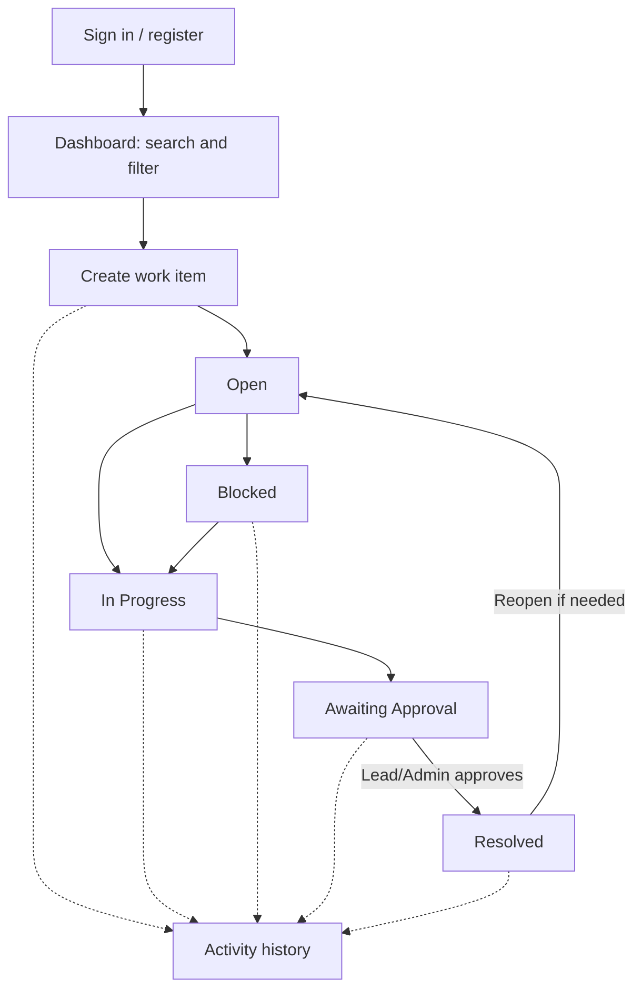

# OpsFlow workflow

## Happy path

1. A member signs in and creates an item with a title, description, type, priority, and optional due date.
2. The item is visible to authorized users in that team.
3. An assignee works on it, updates status, and adds comments for handoffs.
4. A lead/admin moves it to `Awaiting Approval`.
5. A lead/admin approves it; the API atomically checks the version and current status, then resolves it.
6. The activity panel shows who changed the item and when.

## Failure and edge cases to demonstrate

- Stale write: two clients read version 1. Client A saves, creating version 2. Client B sends `If-Match: 1`; API returns `409`, preserving A's update.
- Unauthorized access: a member from another team requests an item; API returns `403`.
- Role violation: a member tries to approve or submit for approval; API returns `403`.
- Invalid workflow: a user tries to approve an item that is not awaiting approval; API returns `409`.
- Duplicate account: registering an existing email returns `409`.
- Validation failure: malformed title, priority, status, or payload returns `400`.

## Suggested live demo sequence

1. Register a member in the `Operations` team.
2. Create a high-priority payment investigation.
3. Add a comment and show activity history.
4. Promote a second account to `lead` with the documented local `mongosh` command, sign in as that lead, and move an item to approval then resolve it.
5. Demonstrate a stale update by submitting an old `If-Match` version from the API client.
6. Explain the documented limitation that item changes and activity writes are not yet transactional.
